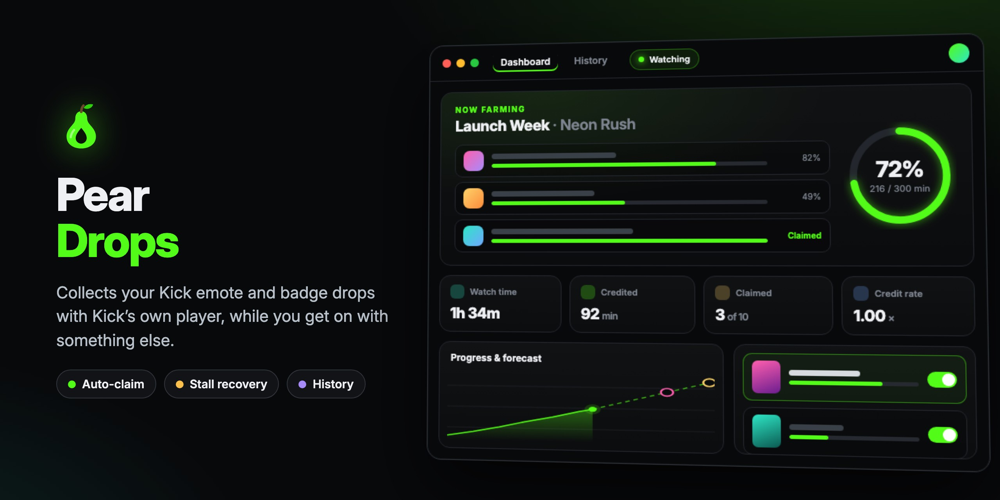

<p align="center"></p>

# Pear Drops

A desktop app that collects Kick **emote and badge drops** for you. Sign in once and it:
- finds a live stream that counts for each drop, with channels you follow first
- watches it with Kick's real player, muted at the window
- claims rewards the moment they unlock
- moves on to the next category when one is done

Game drops that need a linked game account are skipped unless you turn them on.

## Features

- **Live dashboard:** the drop being farmed, a progress ring and ETAs, a credited-minutes chart with a forecast to each reward, a live monitor of watch events vs credits, and session stats. It fits a maximized window without scrolling.
- **Drop queue:** every active emote/badge campaign grouped by category, with live stream counts and a bar of minutes watched with each reward's icon where it unlocks. Drag to reorder, or switch categories off. Or let **Smart order** sort it: what runs out of time first, with drops that are rarely live caught while they're on (it learns how often each category has a stream over the past week; Settings › Farming sets how much that counts and how readily it switches).
- **Done:** finished drops, and missed ones that ended with rewards left, in their own tab. Each drop's details, your last known progress and its artwork are saved on this computer, so they stay after Kick removes them. A drop Kick lists again with a new end date goes back into the queue.
- **Recovers by itself:**
  - stalled progress: reloads, then switches streams after a set time without credit (20 minutes by default)
  - offline, banned or crashed streams
  - streamers changing category
  - sleep and wake
- **Conflict alarm:** Kick credits **one stream per account**. If the player keeps sending watch events and none are credited, another Kick stream on your account (a multiview, another tab, the phone app) is taking the credit. The app chimes, notifies you and shows a banner.
- **History:** a permanent local log of everything: credits, unlocks, claims, stalls, reloads, crashes, switches, conflicts and completions. It has an overview (daily activity, when you farm, efficiency, top channels), a per-drop view, a timeline, and watch-session and channel tables.
- **Menu bar / tray:** closing or minimizing keeps it farming. The tray icon is a progress ring, and its popover shows the current drop, ETAs and quick controls.
- **Stream and chat** dock beside the dashboard. You can collapse them, and stream sound is always muted at the window. Its header has a Follow / Following button (the same Kick calls as kick.com's own button); followed channels are watched first.
- **Updates from GitHub** (Settings › Updates): checks the project's latest release, with its notes and a What's new timeline. Installed copies download the new installer (on a Mac, the app swaps itself in on restart); copies run from source get the new files, keeping a backup. After an update, the app shows what changed once.
- **Font** (Settings › App): your computer's own font on macOS and Windows, or Inter, which comes with the app and looks the same everywhere. Linux uses Inter by default.

## Getting started

Needs [Node.js](https://nodejs.org) 24 or newer.

```sh
npm install
npm start          # switches on login encryption, then starts the app
```

Or double-click `start-mac-linux.sh` / `Start Pear Drops.bat`.

On first open, click **Sign in with Kick** and log in in the window that appears. Then close any other Kick streams on your account; see *How Kick drops work* below.

### Try it without an account

```sh
npm run demo       # stand-in Kick with made-up campaigns, channels and a week of history
```

## How Kick drops work (what the app relies on)

- Kick's web player sends a `tracking.user.watch.livestream` event over its WebSocket about every **2 minutes** while the video is playing. Each credited event adds 2 minutes to the campaign's progress.
- Kick credits only **one stream per account at a time**. Watching drops in this app while a multiview or another tab plays Kick on the same account will stall it.
- Muting doesn't matter to Kick. Here the window is muted and the player stays unmuted, because browsers throttle muted background video.

The app never sends watch events itself. It runs the real kick.com channel page, so the traffic matches a normal viewer's.

## Privacy and security

- Your Kick login is stored only in the app's own browser session on this computer. It is encrypted with your system keychain (macOS Keychain / Windows DPAPI) via Electron's cookie-encryption fuse (`scripts/harden.js`, run by `npm start`).
- The login token is read inside the kick.com page and never passes through the app's own code or IPC.
- *Settings › Forget my login when I quit* signs you out on every quit. If the app crashed, it does this at the next start instead.
- Settings, history and the drop archive are plain files in the app's data folder (`settings.json`, `history.jsonl`, `drops.json` and `drop-images/`) and never leave your computer.

## Development

| Command | What it does |
|---|---|
| `npm run dev` | Dev copy with a throwaway data folder (`-- --profile <name>` keeps it, `-- --debug` opens a debug port) |
| `npm run demo` | Dev copy against the stand-in Kick |
| `npm test` | Unit tests (`test/unit/`, mirrors `src/`) |
| `npm run test:setup` | Installs Playwright (once) for the launch tests |
| `npm run test:launch` | The real app in demo mode, hidden and muted (`test:launch:visible` to watch) |
| `npm run test:coverage` | Unit coverage, checked against `test/coverage-min.json` (minimums only go up: `-- --update`) |
| `npm run dist:mac` / `dist:win` | Installers in `dist/` |
| `npm run icon` | Renders `build/icon.svg` to the app and installer icons |

### Project structure

```
src/main/        Electron main process
  main.js        windows, IPC, sign-in, tray, demo wiring
  farmer.js      the engine: picks streams, tracks progress, recovers, claims, records history
  kick-api.js    Kick API calls, made from a hidden kick.com page
  watcher.js     the docked kick.com channel page (and offscreen mirror for captures)
  history.js     permanent event log and its aggregations
  archive.js     saved copies of every drop seen (details, progress, images)
  updates.js     update checks, downloads and installs (updater.js: GitHub, zips, signatures)
  tray.js        menu bar / tray icon and popover
  security.js    login encryption migration, forget-on-quit, session lock-down
  demo.js        stand-in Kick for tests, demos and the trailer
src/preload/     bridges for the app pages and the channel page
src/renderer/    the dashboard, history and tray pages (plain JS, no build step)
test/unit/       node --test unit tests
test/launch/     Playwright launch tests against the real app
scripts/         dev, coverage, hardening, icon and release tools
build/           installer hooks and icon source
.github/assets/  the README's hero image (hero.jpg) and the page it's drawn from (hero.html)
```

The app's own pages never use system pop-ups such as `alert`, native message boxes or date pickers. `test/unit/no-system-popups.test.js` checks for them.

### Releases and updates

The app updates from the GitHub repository in `package.json`'s `updateRepo` (or the one entered in Settings › Updates). Until one is set, Settings › Updates says so and nothing is checked.

Pull requests never change the version or `CHANGELOG.md`. Write their titles as one line a user would understand: they become the What's new entries.

**Publishing an update:**
1. **Releases → Draft a new release.** Tag it with the new version (e.g. `v0.2.0`, *Create new tag on publish*, target `main`).
2. **Generate release notes**, tidy them, and **Publish release**.

The **Build installers** workflow then sets the version from the tag and adds the notes to `CHANGELOG.md` (`scripts/prepare-release.js`), commits that to `main`, builds the installers and attaches them (Windows `.exe`; Mac `.dmg`, plus the `-mac.zip` the app uses to update itself). The commit needs a deploy key with write access in the secret `RELEASE_DEPLOY_KEY`; the workflow explains what's wrong if it's missing.

A Mac app only swaps itself in when the new build is signed with the same certificate (see below). Otherwise it downloads the disk image to drag in.

### Mac signing and the Keychain

The saved Kick login is encrypted with a key in the macOS Keychain. macOS only hands that key to "the same app" without asking, and it judges that in two ways:
- **The app's access list** ("Always Allow"): any stable certificate is enough.
- **The item's partition list**: this needs the certificate's **Apple Team ID**. Without one, macOS records each build's exact fingerprint (`cdhash`), so it asks for your password after every update.

Builds sign with the best identity on the Mac (`build/after-sign.js`):
1. a *Developer ID Application* certificate (paid Apple Developer account; with notarization, it also removes Gatekeeper's first-launch warning)
2. an *Apple Development* certificate (free: Xcode › Settings › Accounts › your Apple ID › Manage Certificates › +)
3. the self-signed "Pear Drops Local Signing" certificate (`npm run signing-cert`)
4. ad hoc

Only the first two stop the Keychain prompt after updates. Release builds should use a Developer ID: add it to the repository secrets `MAC_CERT_P12` and `MAC_CERT_PASSWORD`, and keep the same one from release to release.

## Notes and limitations

- Kick can change its site or API at any time. If drops stop progressing, check the History view's timeline for errors.
- Some campaigns require a specific channel. When none of those channels is live, the category waits ("Offline") and the app farms the next one.

## Disclaimer

Pear Drops isn't affiliated with or endorsed by Kick. Automating watch time may be against Kick's terms; use it at your own risk.
